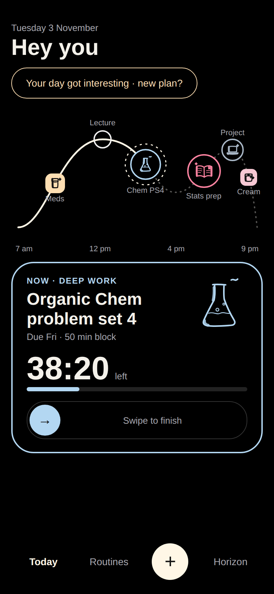
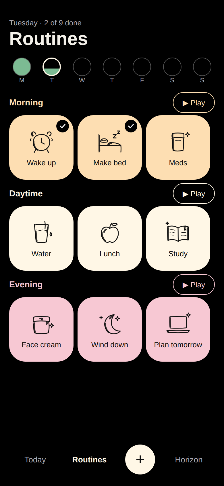

# Arc

A whimsical, adaptive planner for exams, assignments, projects and the little daily routines (meds, face cream, making the bed). Arc plans backwards from your deadlines around your daily goal and your energy through the day. When the day drifts, it **proposes** a new plan as a diff and nothing moves until you approve it. Black and pastel, hand-drawn doodles, and never guilt: skipped things are just "sleeping in".

<p align="center"> </p>

**Live app:** `https://<your-github-username>.github.io/arc-planner/` (this appears once you publish your copy; see [Publish](#publish)).

The app is a Go core compiled to WebAssembly inside a small vanilla-JS installable web app (PWA). It is hosted free on GitHub Pages, and all data stays on your device.

---

## Install on iPhone
1. Open the live URL in **Safari**.
2. Tap **Share** (the square with an arrow), then **Add to Home Screen**, then **Add**.
3. Open Arc from the home screen. It runs full screen and works offline.

> Use the installed app rather than a Safari tab. iOS may clear storage for sites that aren't installed and haven't been visited for a while.

## Install on Windows
1. Open the live URL in **Edge** or **Chrome**.
2. Click the **Install** icon at the right end of the address bar (or the **⋯** menu, then **Apps**, then **Install Arc**).
3. Arc gets its own window and a Start menu entry, and it works offline.

## Back up your data
Your data lives only in this browser on this device. Back it up now and then:
- **Settings → Back up your data → Save a backup** saves `arc-backup-YYYY-MM-DD.json` (on iPhone, use the share sheet to save it to Files).
- **Settings → Restore from a backup** shows what the file contains and asks before it replaces anything.
- **Settings → Calendar → Export to calendar** gives you an `.ics` file of routines, events and (optionally) your plan. Routines come with alarms, so your phone's Calendar reminds you even when Arc is closed.

## Use your own copy
Anyone can run their own Arc for free:
1. On GitHub, click **Use this template** (or **Fork**), and name the repo whatever you like.
2. In your new repo go to **Settings → Pages**, and under **Build and deployment → Source** pick **GitHub Actions**.
   (Or with the GitHub CLI: `gh api -X POST repos/<you>/<repo>/pages -f build_type=workflow`.)
3. Push any commit, or run the **Deploy Pages** workflow from the **Actions** tab. Your copy goes live at `https://<you>.github.io/<repo>/`.

Nothing in the code names an owner or a repo. Every URL is relative, so the app works under any repo name and any sub-path.

## Run locally
You need [Go](https://go.dev/dl/) 1.24 or newer. Nothing else is needed (no Node, no make).
```sh
go run ./tools/dev            # builds into dist/ and serves http://localhost:8080
go run ./tools/dev -port 9000 -host 0.0.0.0   # reachable from your phone on the same Wi-Fi
go run ./tools/build          # just build dist/
go test ./...                 # run the core's tests
```
All of these work the same on Windows, macOS and Linux. Visit `http://localhost:8080/__rebuild` to rebuild without restarting the server.

## Repository structure
The repo is split between the Go scheduling engine, the browser app shell, design references, and tooling.

```text
arc/
├─ .github/workflows/          CI + Pages deploy workflow files
├─ cmd/
│  └─ arc-wasm/                Go entry point that exposes the planner to the browser
├─ internal/
│  ├─ model/                   shared data types + JSON envelope helpers
│  ├─ planner/                 scheduling, re-planning and acceptance logic
│  ├─ parse/                   quick-add natural-language parser
│  ├─ doodle/                 keyword-to-doodle matching and asset selection
│  ├─ ics/                    calendar import/export support
│  ├─ postcard/               end-of-day summary generation
│  └─ ...                     other Go implementation files
├─ web/
│  ├─ css/                    app styling
│  ├─ data/                   bundled sample JSON and doodle data
│  ├─ fonts/                  bundled font files
│  ├─ js/
│  │  ├─ anim.js              animation helpers
│  │  ├─ arc.js               planner bridge and app bootstrap
│  │  ├─ state.js             app state and persistence logic
│  │  ├─ rough.js             hand-drawn SVG drawing helpers
│  │  ├─ ui/                  screen-specific browser UI modules
│  │  └─ ...                  other app logic (router, sound, store, etc.)
│  ├─ index.html              app shell
│  ├─ manifest.template.json  PWA manifest template
│  ├─ offline.html            offline fallback page
│  ├─ sw.template.js          service worker template
│  └─ ...
├─ logos/                      built logo variants for different themes
├─ reference/
│  ├─ README.md               reference index
│  ├─ SPEC.md                 build and product spec
│  ├─ doodles/                doodle source and keyword definitions
│  ├─ inspiration/            visual inspiration images
│  ├─ logos/                  original logo references
│  └─ mockups/                HTML + PNG mockups for the app screens
├─ tools/
│  ├─ build/                  production build tooling
│  ├─ dev/                    local dev server tooling
│  └─ e2e/                    Playwright smoke/perf/accessibility checks
├─ dist/                       generated production build output
├─ arc.config.json            app name, theme, and selected logo
├─ go.mod                      Go module definition
├─ README.md                   project overview and usage docs
├─ CHANGELOG.md                release notes
├─ CLAUDE.md                  local Copilot instructions for this repo
├─ DECISIONS.md                architecture and product decisions
├─ PROGRESS.md                 ongoing engineering notes
├─ LICENSE                     MIT license
├─ .gitignore                  git ignore rules
├─ .github/                    GitHub Actions and repo automation
└─ ...                         generated assets and other repo metadata
```

If you are looking for the highest-value places to read first, start with `internal/planner`, `internal/model`, `web/js`, and the design references in `reference/`.

## Change the name or logo
Everything lives in `arc.config.json`:
```json
{ "name": "Arc", "shortName": "Arc", "logo": "B", "themeColor": "#000000", "backgroundColor": "#000000", "description": "…" }
```
- **Logo:** pick `A` (sunrise over the arc), `B` (sparkle tile) or `C` (squiggle A), or try one without editing the file: `go run ./tools/build -logo C`. This sets the home-screen icon, favicon and the in-app mark. The in-app mark can also be switched in **Settings → Look & feel**, but the home-screen icon only changes with a rebuild.
- **Name:** change `name` and `shortName`, then rebuild and push. No code edits needed.
- **Your own logo:** add a `logos/D/` folder with the same file names as `logos/B/` and set `"logo": "D"`.

After a new deploy, installed copies show **"A new version is ready, tap to refresh"**. iOS caches home-screen icons, so remove and re-add the app to see a new icon.

## Publish
These are the exact commands, run from this folder with the [GitHub CLI](https://cli.github.com/) logged in (`gh auth login`):
```sh
gh repo create arc-planner --public --source=. --remote=origin --push
gh repo edit --template
gh api -X POST "repos/$(gh api user -q .login)/arc-planner/pages" -f build_type=workflow   # use -X PUT if Pages already exists
gh run watch                                   # wait for the "Deploy Pages" run to finish
gh release create v1.0.0 --generate-notes      # after the live site works
```
The site is then at `https://<your-username>.github.io/arc-planner/`.

---

## A tour of the Go code (for Go learners)
The interesting logic is plain Go with no browser, database or file access, so you can read it and test it like any library. The browser is a thin shell around it.

| Package | What it does | Good file to start with |
|---|---|---|
| `internal/model` | The shared types (`Item`, `Block`, `Plan`, `Profile`…) and the JSON envelope `{"ok":true,"data":…}`. `Handle` turns any `func(T) (R, error)` into a JSON-in/JSON-out function that never panics. | `json.go` |
| `internal/planner` | The scheduler. It builds a 5-minute slot grid for each day, places routines at their anchors, then spreads each deadline's work over the eligible days by energy level (`plan.go`). `replan.go` diffs the old and new plans into proposed changes, and `ApplyChanges` applies only what you accepted. | `plan.go`, then `plan_test.go` |
| `internal/parse` | The quick-add parser: "chem exam nov 20, want 12h prep" becomes an exam on Nov 20 at 9:00 with 12 h of prep. It is rule-based and deterministic. | `quickadd_test.go` |
| `internal/doodle` | Picks one of 16 doodles by keyword score. It shows `go:embed` and stable tie-breaking. | `match.go` |
| `internal/ics` | Reads and writes calendar files (RFC 5545 subset): line folding, time zones, weekly repeats, EXDATE, alarms. | `write.go` |
| `internal/postcard` | Lays out the end-of-day postcard with a tiny seeded random generator, so the same day always looks the same. | `compose.go` |
| `cmd/arc-wasm` | The `//go:build js && wasm` entry point. It registers `globalThis.arc.plan(...)` and friends with `syscall/js`, then blocks forever with `select{}`. | `main.go` |
| `tools/build`, `tools/dev` | The build pipeline and dev server, in ordinary Go instead of shell scripts, so they work on Windows. | `tools/build/main.go` |

A few ideas show up throughout:
- **Determinism.** The core never calls `time.Now()` (the current time is an input) and never relies on map order. The tests run every function twice and compare the bytes.
- **Property tests.** `TestInvariantsGenerated` feeds 150 random schedules through the planner and checks the rules that must always hold: no overlaps, buffers respected, minutes add up, no day over its limit.
- **Table-driven tests** everywhere. Run `go test -cover ./...` to see coverage, which is about 90–97% per package.

The browser side (`web/`) is ES modules with no framework or bundler. `js/anim.js` is a small spring-physics engine, `js/rough.js` draws the slightly wobbly hand-drawn outlines, `js/state.js` holds the app state and talks to IndexedDB and the Go core, and `js/ui/*.js` are the screens. The dev-only Playwright checks live in `tools/e2e` (`node run.mjs`, `node shots.mjs`, `node perf.mjs`) and are never part of the app.

## Privacy
Arc has no accounts, no servers, no analytics and no third-party requests. Fonts and doodles are bundled. Your items, plans and postcards live in your browser's storage on your device and only leave it when you export a backup or calendar file yourself. The repository contains no personal data.

## Known limitations
- **No push notifications.** Web push is out of scope. Export your routines to your calendar (Settings → Calendar); they carry alarms, so the phone reminds you.
- **Storage can be evicted.** iOS may clear data for sites that aren't installed. Install to the home screen and keep a backup.
- **One device at a time.** Data is per device and per browser. Move it with backup and restore. (An optional self-hosted sync server is a possible future addition.)
- **First load downloads the planner** (about 1.8 MB compressed). The app is usable in under a second; planning features become ready about 2 seconds later on a mid-range phone, and are instant once cached.
- The calendar import covers the common subset: daily and weekly repeats, time zones, exceptions and all-day events. Monthly and yearly repeats are listed as skipped with a reason.

## License
MIT. Fredoka is included under the SIL Open Font License (`web/fonts/OFL.txt`).